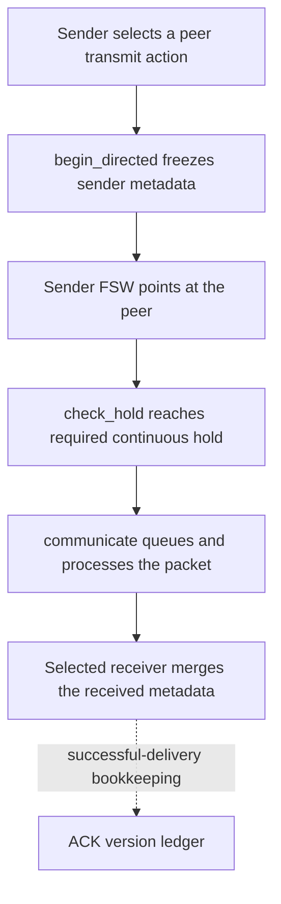

# Actual directed transmit execution

The implementation and its audit now live in the canonical
`multi-agent-space-imaging-2026` checkout. The October 8 original audit package,
its frozen source, diagnostic prints, and one-way zero-delay probe are retained
under `output/transmit-audit-2026-10-08/` at the repository root. That package
tested the earlier `completion` case at `e7b0d40` plus its recorded dirty patch.
Its 64 checks must not be attributed retrospectively to the later inventory case.

## One sender and one selected receiver

The payload path is one-way. No receiver catalog is sent back unless that
spacecraft later chooses its own transmit action. `communicate()` currently
updates both directions of its version/last-contact bookkeeping; those updates
do not merge the receiver's private records into the sender's catalog. The sender
does obtain ideal successful-delivery feedback. That acknowledgment assumption
is distinct from the actual metadata payload.

Current code wiring:

- `src/bsk_rl/act/completion_actions.py`: `TransmitCompletions.set_action()`
  freezes the payload with `begin_directed()` and enables the sender's pointing
  task. `check_hold()` marks the end of the physical gate.
- `src/bsk_rl/comm/completion_communication.py`: `communicate()` queues the
  finished transmission and merges only into `catalogs[packet.receiver]`.
- The legacy case calls receiver-local `merge_record()`; `catalog_tx` calls
  receiver-local `receive_inventory()` with the frozen owner snapshot. Physical
  image ownership and ground-delivery reward remain with the source spacecraft.

## Expected and measured timing

No additional channel delay is necessary for the default ideal channel. Both
the original zero-delay probe and the newer nominal inventory fixture receive
the packet at the hold-completion boundary, with no post-hold wait.

| Fixture | Expected | Actual |
|---|---|---|
| Legacy completion, only A transmits | B learns A's fact; A never learns B's private fact; C and D unchanged | Hold and receipt both at 112 s; all assertions passed |
| Native inventory nominal | Selected receiver learns the two frozen owner facts; no image bytes or reward move | 660 bytes; sender holds for 10 s; hold and receipt both at 108 s; zero mission reward |

The remaining elapsed time comes from acquiring body pointing and satisfying
`required_hold_s = max(transmit_hold_s, 8 * payload_bytes / metadata_bitrate_bps)`.
The 10 s minimum is a declared model choice, not light-travel time. At 64 kbit/s,
660 bytes alone take 0.0825 s; the configured minimum dominates that fixture.
This is defensible for a study that explicitly charges pointing/terminal-acquisition
cost. It is not a measured radio model. An omnidirectional RF design would need
a different pointing/acquisition contract rather than inheriting this hold merely
because the current code reuses the imaging attitude controller.

Delay, loss, expiry, and receiver-alive checks are configurable channel/status
rules. Defaults have delay=0 and loss=0. Fault/expiry tests exercise those branches;
their existence does not require adding delay or loss to a nominal experiment.

## Consolidated-source verification

The canonical source passed 210 multi-agent unit tests and 13 native integration
tests. Seven native inventory canaries passed: nominal one-way receipt,
delay/loss/retry, exact TTL boundary, broken hold/reacquisition, cancellation/deadline,
frozen owner revisions, and geometry-only control. Naming changes additionally
passed the two W&B logging regressions. These are functional checks, not learned
mission performance or hardware-link validation.

Raw logs and native packet/hold traces are in
`output/branch-consolidation-2026-10-08/`. No PPO updates or full-mission runs were
performed by these canaries.
